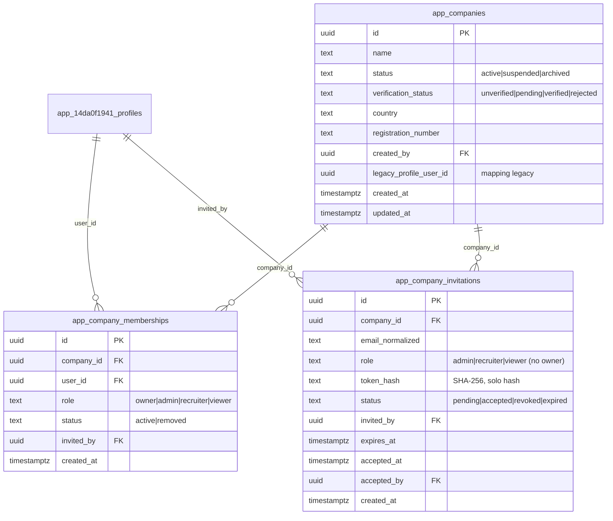

# PB-CE-COMPANY-CORE-001 — ADR: Company tenant, memberships and team accounts

> **Ticket:** PB-CE-COMPANY-CORE-001 — Company tenant, memberships and team accounts foundation
> **Estado:** IN PROGRESS (implementación en rama; NO merge/producción hasta GO explícito del PO)
> **Base obligatoria:** `5e1da21fb69fb2748dee84fbd151cb2a0b22ea11` · **Rama:** `pb-ce-company-core-001`
> **Fecha:** 2026-10-16 · **Autor:** Verdent (ejecución autorizada por GO del PO)

---

## 1. INVENTARIO DEL SISTEMA LEGACY (auditoría previa obligatoria)

### 1.1 Cómo se representa hoy una empresa

**Tabla `app_14da0f1941_profiles`** (un perfil por usuario):
- `role` (text, default `'user'`): `admin` para el moderador de plataforma.
- `account_type` (text, default `'worker'`): `worker` | `company` | `user`.
- `company` (text, nullable): nombre de empresa en texto libre.
- `company_verified` (bool, default `false`), `company_status` (text, default `'pending'`).
- `company_industry`, `company_country`, `company_website`, `company_description` (text).

**Auth metadata:** `user_metadata.account_type` y `localStorage 'pipingbox_account_type'` (manipulables por el cliente; NO fuente de verdad).

**Conclusión:** la empresa es un **atributo del perfil individual**, no una entidad. No hay tenant. El acceso empresa se decide por `company_user_id = auth.uid()` (un único dueño).

### 1.2 Propiedad de jobs / applications / workforce

| Tabla | Columna de propiedad | RLS clave |
|---|---|---|
| `app_14da0f1941_jobs` | `company_user_id` (uuid) | `jobs_*_own_or_primary_admin`: `company_user_id = auth.uid()` OR email del admin primario. `pb_public_read_open_jobs`: `status='open'` |
| `app_14da0f1941_job_applications` | `company_user_id` (uuid) | `applications_company_*_own_jobs`: `company_user_id = auth.uid()`. Worker: `user_id = auth.uid()`. Admin: email primario |
| `app_14da0f1941_workforce_requests` | `email` (text) | empresa lee por email propio |

### 1.3 RLS / RPC / SECURITY DEFINER que dependen de roles empresariales

- `pb_is_admin()`, `app_is_admin()`, `is_admin_user()` (SECURITY DEFINER, boolean): `profiles.role='admin'` del `auth.uid()`.
- `app_update_application_status()` (SECURITY DEFINER, jsonb): máquina de estados canónica.
- `admin-verify-company` (Edge Function): actualiza `company_verified`/`company_status` del perfil (requiere `role='admin'` del llamante).

### 1.4 Cuentas empresariales existentes a migrar

Verificación 2026-10-16 (producción):
- `account_type='company'`: **4 cuentas** → 2 con `company_verified=true, company_status='approved'`, 2 con `company_verified=false, company_status='pending'`.
- 44 workers tienen el campo `company` relleno (NO se migran: son atributo de su perfil worker).

**Mapping legacy:** cada una de las 4 cuentas `account_type='company'` produce 1 `app_companies` + 1 membership `owner` para su `user_id`. Trazable por `legacy_profile_user_id`.

### 1.5 Mecanismos de invitación y correo reutilizables

- **Email:** `_shared/email-provider.ts` (SMTP one.com + Resend, modo `capture` para QA) + `_shared/email-i18n/` (11 locales). Reutilizable para invitaciones.
- **Audit log:** `app_14da0f1941_audit_logs` (7 columnas: id, created_at, actor_email, action_type, target_type, target_id, details) con policies `al_admin_*` + `al_insert_authenticated` (insert por authenticated). Reutilizable.
- **Edge Functions existentes:** patrón `createClient(service_role)` + validación `role='admin'` del llamante. Reutilizable para RPCs de empresa.
- **Job invitations (tabla existente):** `app_14da0f1941_job_invitations` — dominio distinto (invitar candidato a oferta), NO reutilizable para team accounts.

### 1.6 Conclusión del inventario

**El perfil individual NO puede convertirse directamente en tenant.** Se requiere una capa `app_companies` independiente + memberships. La transición usa compatibilidad temporal: las tablas de trabajo (`jobs`, `applications`) siguen colgando de `company_user_id` en esta fase; el tenant nuevo solo gobierna **equipo y membresías** (quién puede actuar como empresa), sin tocar aún la propiedad de datos de producción.

---

## 2. ADR — DECISIONES DE ARQUITECTURA

### ADR-1: `app_companies` como entidad independiente

**Decisión:** nueva tabla `app_companies`. Separada de `profiles`.

**Motivo:** el GO prohíbe asumir que el perfil se convierte en tenant. Separación identidad/empresa permite multi-membresía, verificación independiente y ciclo de vida propio (activa/suspendida/archivada).

### ADR-2: Seguridad por memberships activas, no por `company_id` en perfil

**Decisión:** toda autorización se resuelve contra `app_company_memberships` (user_id, company_id, role, status='active'). NUNCA se lee un `company_id` o `role` del perfil ni de metadata del cliente.

**Motivo:** el GO exige explícitamente que la seguridad no se base en una única `company_id` manipulable. Las memberships en BD (con RLS) son la única fuente de verdad.

### ADR-3: Compatibilidad temporal, no migración destructiva de datos de trabajo

**Decisión:** en esta fase, `jobs`/`applications`/`workforce_requests` mantienen su modelo `company_user_id`. El tenant nuevo añade gobierno de equipo sin romper producción. Una fase posterior (fuera de alcance) re-mapeará la propiedad de datos al tenant.

**Motivo:** GO §4 exige migración no destructiva, idempotente, reversible y sin pérdida. Re-mapear `company_user_id` de 49 candidaturas reales a un tenant nuevo en la misma migración que crea el modelo sería de alto riesgo. Se hace en dos pasos.

### ADR-4: Tokens de invitación solo en backend, hash persistido

**Decisión:** `app_company_invitations.token_hash` (SHA-256). El token plano solo se devuelve una vez en la respuesta del RPC de invitación (para el email) y nunca se almacena. Aceptación por RPC que compara hash.

**Motivo:** GO §2 exige token backend-only, solo hash persistido, un solo uso, expiración, revocación, anti-replay.

### ADR-5: RPCs SECURITY DEFINER para toda mutación de equipo

**Decisión:** create_company, invite_member, accept_invitation, change_role, remove_member, transfer_ownership, select_company_context como funciones `SECURITY DEFINER` con `search_path` fijo. Las tablas tienen RLS FORCE y cero acceso directo de escritura para `authenticated`.

**Motivo:** GO §5 exige validación interna del actor/empresa/rol/recurso en backend, no confiar en el frontend. SECURITY DEFINER permite ejecutar la lógica de negocio (invariantes de owner, atomicidad de transferencia) con privilegios controlados sin exponer escritura directa.

### ADR-6: Invitación por email + Edge Function para el envío

**Decisión:** el RPC `invite_member` crea la fila de invitación (hash) y devuelve el token plano UNA vez al llamante autorizado; una Edge Function `company-invite-email` (patrón admin-verify-company) renderiza y envía el email i18n. La aceptación requiere cuenta autenticada cuyo email (normalizado) coincide con el destinatario.

**Motivo:** reutiliza email-provider + i18n existentes; separa generación de token (BD) de transporte (Edge); anti-enumeración en respuestas.

### ADR-7: Invariantes de owner por constraint + lógica en RPC

**Decisión:** "toda empresa activa conserva ≥1 owner", "no degradar/eliminar al último owner", "transferencia atómica", "admin no toca owners" se implementan DENTRO de los RPCs SECURITY DEFINER (transacción única), no por triggers frágiles. Un partial unique index `app_companies_one_owner_per_company` no basta (varios owners permitidos); la regla es "≥1 owner", que se valida en la transacción.

**Motivo:** GO §3 exige estas invariantes de forma atómica; solo una transacción en el RPC garantiza atomicidad frente a cambios de rol concurrentes.

---

## 3. MODELO DE DATOS



### Invariantes de integridad
- `UNIQUE(company_id, user_id)` en memberships (una membresía por usuario/empresa; el rol se actualiza, no se duplica).
- `UNIQUE(company_id, email_normalized) WHERE status='pending'` en invitations (idempotencia de invitaciones duplicadas).
- CHECK constraints para enums de status/role.
- Índices en `memberships(user_id)`, `memberships(company_id)`, `invitations(email_normalized)`, `invitations(token_hash)`.

---

## 4. MATRIZ DE ROL → PERMISOS (RPC-level)

| Acción | owner | admin | recruiter | viewer |
|---|:-:|:-:|:-:|:-:|
| Ver empresa | ✅ | ✅ | ✅ | ✅ |
| Ver equipo | ✅ | ✅ | ✅ | ✅ |
| Invitar recruiter/viewer | ✅ | ✅ | ❌ | ❌ |
| Invitar admin | ✅ | ❌ | ❌ | ❌ |
| Cambiar rol (recruiter↔viewer) | ✅ | ✅ | ❌ | ❌ |
| Cambiar rol (a/de admin) | ✅ | ❌ | ❌ | ❌ |
| Cambiar rol (a/de owner) | ✅ (no a sí mismo como último) | ❌ | ❌ | ❌ |
| Retirar miembro (recruiter/viewer) | ✅ | ✅ | ❌ | ❌ |
| Retirar miembro (admin) | ✅ | ❌ | ❌ | ❌ |
| Retirar owner | ✅ (no último) | ❌ | ❌ | ❌ |
| Transferir ownership | ✅ (atómico) | ❌ | ❌ | ❌ |
| Revocar invitación | ✅ | ✅ | ❌ | ❌ |
| Seleccionar contexto empresa | ✅ | ✅ | ✅ | ✅ |

---

## 5. SEGURIDAD RLS

Todas las tablas: `ENABLE ROW LEVEL SECURITY` + `FORCE ROW LEVEL SECURITY`.
- **app_companies:** SELECT = miembro activo de la empresa (via memberships). INSERT/UPDATE/DELETE = solo vía RPC SECURITY DEFINER (sin policy de escritura directa para authenticated).
- **app_company_memberships:** SELECT = miembro activo de la misma empresa (o el propio user_id). Escritura = solo RPC.
- **app_company_invitations:** SELECT = miembro admin/owner de la empresa (para listar invitaciones pendientes) — NUNCA por email del invitado (anti-enumeración). Escritura = solo RPC.
- **Grants:** `authenticated` SELECT en las 3 (RLS filtra); INSERT/UPDATE/DELETE revocados (solo RPC SECURITY DEFINER). Cero `anon`/`PUBLIC`.
- Funciones helper SECURITY DEFINER con `search_path = public, pg_temp`: `pb_is_company_member(company_id)`, `pb_company_role(company_id)`, `pb_is_company_admin_or_owner(company_id)`.

---

## 6. AUDITORÍA Y OBSERVABILIDAD

**Audit log:** los RPCs insertan en `app_14da0f1941_audit_logs` (actor_email del JWT, action_type, target_type='company'|'company_membership'|'company_invitation', target_id, details JSON sin PII sensible — sin tokens).

**PostHog (sin PII, allowlist cerrado):**
```
company_created            {company_id}
company_invite_sent        {company_id, role}
company_invite_accepted    {company_id, role}
company_invite_revoked     {company_id}
company_member_role_changed{company_id, role}
company_member_removed     {company_id}
company_owner_transferred  {company_id}
company_context_selected   {company_id}
```
Solo UUIDs técnicos + enums de rol. Nunca email/nombre/teléfono/token.

---

## 7. FLUJOS DE INTERFAZ (primer corte)

Rutas nuevas bajo `/company/`:
- `/company/create` — crear/inicializar empresa.
- `/company/overview` — vista básica de empresa.
- `/company/team` — página de equipo (miembros + invitaciones pendientes).
- `/company/invite` — invitar miembro (modal/página).
- `/company/invite/accept` — aceptación/rechazo (deep-link con token).
- Selector de empresa activa en el AppShell cuando el usuario tiene >1 membership activa.

Todas las cadenas vía i18n (`useTranslation`), 11 locales, sin strings hardcodeadas.

---

## 8. FUERA DE ALCANCE (confirmado)

Billing, precios, compliance view, document requests, credential verification, private pools, matching, WhatsApp, SSO/API, multi-entidad, importaciones masivas, outreach, datos reales de clientes, re-mapeo de `company_user_id` de jobs/applications al tenant (fase posterior).

---

## 9. LIMITACIONES CONOCIDAS (para el informe QA)

1. La propiedad de datos de trabajo (`jobs.company_user_id`, `applications.company_user_id`) sigue siendo por usuario individual; el tenant solo gobierna equipo. Re-mapeo diferido.
2. Las 4 cuentas legacy se migran a tenants pero sus jobs existentes permanecen bajo su `company_user_id` original (funcionalmente idéntico hasta la fase de re-mapeo).
3. `admin-verify-company` (verificación de empresa) sigue operando sobre `profiles` en esta fase; la verificación del tenant (`app_companies.verification_status`) se expone pero la fuente de verdad de verificación se unificará en una fase posterior.
4. El selector de contexto empresa almacena la selección en sesión/BD pero NO restringe aún los datos de trabajo por tenant (sólo equipo).
